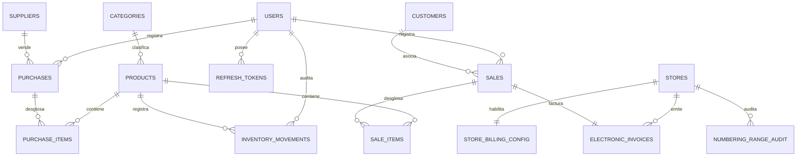

<!-- doc-version: 1.2 | last-updated: 2026-09-22 -->
# Esquema de Base de Datos — Vista Global

## Diagrama Entidad-Relación

## Tabla `refresh_tokens` (módulo auth)
Sesiones de refresh token rotativas (introducida en `V4__Refresh_Tokens.sql`).

| Columna | Tipo | Notas |
|---|---|---|
| id | BIGSERIAL PK | |
| token_hash | VARCHAR(64) UNIQUE | SHA-256 del token opaco (nunca se guarda en claro) |
| user_id | BIGINT | `FK_refresh_tokens_user` → `users(id)` |
| family_id | VARCHAR(36) | Agrupa los tokens rotados de una sesión (revocación en cadena) |
| expires_at | TIMESTAMP | |
| revoked | BOOLEAN | |
| created_at / updated_at | TIMESTAMP | |

## Tabla `store_billing_config` (módulo billing)
Habilitación y credenciales de facturación electrónica **por local** (introducida en `V14__Store_Billing_Config.sql`).
Relación 1 a 1 con `stores`: la PK **es** el `store_id`. Ver DDL completo en `modules/billing/spec.md`.

| Columna | Tipo | Notas |
|---|---|---|
| store_id | BIGINT PK | `FK_store_billing_config_store` → `stores(id)` |
| status | VARCHAR(30) | Etapa de habilitación (CHECK: `NOT_REQUESTED`…`SUSPENDED`) |
| status_reason | VARCHAR(500) | Motivo obligatorio para `REJECTED` / `SUSPENDED` |
| environment | VARCHAR(12) | `SANDBOX` o `PRODUCTION` (CHECK) |
| sandbox_* / production_* | VARCHAR / INT | Dos juegos de credenciales + id de rango por entorno |
| …_client_secret, …_password | VARCHAR(1024) | **Cifrados AES-256-GCM por la aplicación**, nunca en claro |
| updated_by | VARCHAR(100) | Último usuario que modificó la configuración |
| created_at / updated_at | TIMESTAMP | |

## Tabla `store_status_audit` (módulo stores)
Historial inmutable de cambios de estado de un local (`V18__Store_Status_Audit.sql`). Solo se inserta.

| Columna | Tipo | Notas |
|---|---|---|
| id | BIGSERIAL PK | |
| store_id | BIGINT | `FK_store_status_audit_store` → `stores(id)` |
| previous_status | VARCHAR(30) | Nulo en el registro inicial y en el respaldo de V18 |
| new_status | VARCHAR(30) | `PENDING_VERIFICATION`, `ACTIVE`, `REJECTED`, `SUSPENDED`, `INACTIVE` |
| reason | VARCHAR(255) | Motivo (rechazos) |
| performed_by | VARCHAR(100) | Usuario autenticado; nulo en el respaldo de V18 |
| created_at | TIMESTAMP | |

`V20__Store_Status_Audit_Snapshot.sql` elimina la FK a `stores` y añade `store_name`, `store_email` y `store_tax_id` (copia de los datos del local en cada evento, rellenada para las filas previas). Así la auditoría sobrevive a la eliminación definitiva de un local; `new_status` admite también `DELETED`.

Índices: `IDX_store_status_audit_store(store_id, created_at)`, `IDX_store_status_audit_status(new_status, created_at)`.

## Tabla `plans` y columna `stores.plan_code` (módulo stores)
`V22__Store_Plans.sql`. `plans`: `code` PK (`BASIC`, `STANDARD`, `PRO`), `name`, `max_additional_users` (usuarios activos permitidos además del administrador) y `sort_order`. `stores.plan_code` VARCHAR(20) NOT NULL, `DEFAULT 'BASIC'`, `FK_stores_plan` → `plans(code)`; los locales que ya existían pasaron a `PRO`. En `store_status_audit`, `new_status` admite también `PLAN_CHANGED`.

## Tabla `store_user_audit` (módulo stores)
Historial inmutable de asignaciones de usuarios a locales hechas por el SUPER_ADMIN (`V21__Store_User_Audit.sql`). Solo se inserta. Sin FKs a `stores` ni `users`: guarda copia de los datos (`store_name`, `username`, `full_name`, `role`) para sobrevivir a borrados.

| Columna | Tipo | Notas |
|---|---|---|
| id | BIGSERIAL PK | |
| store_id / user_id | BIGINT | Sin FK (snapshot) |
| store_name, username, full_name, role | VARCHAR | Copia al momento de la asignación |
| action | VARCHAR(20) | `OWNER_ASSIGNED` |
| performed_by | VARCHAR(100) | SUPER_ADMIN que la hizo |
| created_at | TIMESTAMP | |

## Tabla `password_reset_tokens` (módulo auth)
Tokens de recuperación de contraseña (`V19__Password_Reset_Tokens.sql`), mismo esquema que `email_verification_tokens`: `token_hash` (SHA-256, único), `user_id` (FK `users`), `expires_at`, `used_at`, `created_at`. Índice `IDX_prt_user(user_id)`.

## Tabla `numbering_range_audit` (módulo billing)
Bitácora de cambios sobre rangos de numeración DIAN (introducida en `V15__Numbering_Range_Audit.sql`).

| Columna | Tipo | Notas |
|---|---|---|
| id | BIGSERIAL PK | |
| store_id | BIGINT | `FK_numbering_range_audit_store` → `stores(id)` |
| range_id | BIGINT | Id del rango en el proveedor (Factus), no es FK local |
| action | VARCHAR(20) | CHECK: `CREATE`, `DELETE`, `ACTIVATE`, `DEACTIVATE`, `UPDATE_CURRENT`, `SET_DEFAULT` (V17) |
| previous_value / new_value | VARCHAR(50) | Valor antes y después del cambio |
| performed_by | VARCHAR(100) | Usuario autenticado que ejecutó la acción |
| created_at | TIMESTAMP | |

## Convenciones
- Motor: PostgreSQL 16 (prod), H2 (dev)
- Normalización: 3FN
- PKs: `id BIGINT AUTO_INCREMENT`. Excepciones: `settings` y `store_billing_config` usan como PK el
  `id` del local (relación 1 a 1 con `stores`), asignada explícitamente por el servicio, no autogenerada.
- Timestamps: `created_at`, `updated_at` en todas las tablas maestras
- Borrado lógico: campo `active BOOLEAN DEFAULT TRUE`
- Tipos monetarios: `DECIMAL(12,2)`
- Nombres de tablas: snake_case, plural
- FKs: `FK_<tabla>_<referencia>` (ej. `FK_products_category`)
- Índices: `IDX_<tabla>_<campo>` (ej. `IDX_products_barcode`)

## Índices de Rendimiento
| Índice | Tabla.Campo | Propósito |
|---|---|---|
| IDX_products_barcode | products(barcode) | Búsqueda POS con lector |
| IDX_products_internal_code | products(internal_code) | Búsqueda interna |
| IDX_sales_created_at | sales(created_at) | Historial y reportes diarios |
| IDX_movements_product_date | inventory_movements(product_id, created_at) | Kardex de producto |
| IDX_customers_identification | customers(identification) | Asociar cliente en POS |
| IDX_refresh_tokens_user | refresh_tokens(user_id) | Purga y consulta de sesiones por usuario |
| IDX_refresh_tokens_family | refresh_tokens(family_id) | Revocación de sesión completa (reuso) |
| IDX_refresh_tokens_expires | refresh_tokens(expires_at) | Limpieza de tokens caducados |
| IDX_electronic_invoices_store | electronic_invoices(store_id) | Historial de facturas aislado por local |
| IDX_store_billing_config_status | store_billing_config(status) | Cola de revisión de habilitación en back office |
| IDX_numbering_range_audit_store_range | numbering_range_audit(store_id, range_id) | Historial de cambios de un rango |

## Migraciones de Base de Datos (Flyway)

Toda modificación al esquema físico de la base de datos (creación de tablas, alteración de columnas, inserción de datos semilla, creación de índices) **DEBE** gestionarse mediante scripts de migración de Flyway.

- **Ubicación obligatoria**: `src/main/resources/db/migration/`
- **Nomenclatura**: `V<Versión>__<descripción_breve_snake_case>.sql`
  - *Ejemplo*: `V1__init_schema.sql` (creación de tablas base).
  - *Ejemplo*: `V2__add_idx_products_barcode.sql` (creación de índice).
- **Inmutabilidad**: Una vez que una migración ha sido mezclada en la rama principal y ejecutada, **NUNCA** debe ser modificada. Cualquier corrección debe realizarse en una nueva versión de migración (ej. `V3__...`).
- **Validación**: Hibernate está configurado con `ddl-auto=validate`, por lo que cualquier discrepancia entre las entidades JPA de Java y el esquema migrado por Flyway provocará un fallo de compilación/arranque de la aplicación.

Nota: El DDL detallado de cada tabla está en el `spec.md` del módulo correspondiente.

