<!-- doc-version: 1.3 | last-updated: 2026-10-16 -->
# Esquema de Base de Datos — Vista Global

Fuente de verdad: las migraciones Flyway en `src/main/resources/db/migration/` (hoy `V1` … `V19`). Este documento es el mapa;
el DDL columna a columna vive en las migraciones y, para los módulos con tablas propias complejas, en su `spec.md`.

## Diagrama Entidad-Relación

```mermaid
erDiagram
    STORES ||--o{ USERS : emplea
    STORES ||--o{ PRODUCTS : cataloga
    STORES ||--o{ CUSTOMERS : atiende
    STORES ||--o{ SUPPLIERS : compra_a
    STORES ||--o{ SALES : vende
    STORES ||--o{ PURCHASES : compra
    STORES ||--o{ INVENTORY_MOVEMENTS : registra
    STORES ||--|| SETTINGS : configura
    STORES ||--o{ NOTIFICATIONS : recibe
    STORES ||--o{ STORE_DOCUMENTS : adjunta
    STORES }o--|| STORE_CATEGORIES : clasifica
    STORES ||--o{ SUPPORT_TICKETS : abre
    STORES ||--|| STORE_BILLING_CONFIG : habilita
    STORES ||--o{ NUMBERING_RANGE_AUDIT : audita
    STORES ||--o{ ELECTRONIC_INVOICES : emite
    STORES ||--o{ ELECTRONIC_CREDIT_NOTES : emite
    STORES ||--o{ ELECTRONIC_DEBIT_NOTES : emite
    STORES ||--o{ PRODUCT_SUBCATEGORIES : define
    USERS ||--o{ PURCHASES : registra
    USERS ||--o{ SALES : registra
    USERS ||--o{ INVENTORY_MOVEMENTS : audita
    USERS ||--o{ REFRESH_TOKENS : posee
    USERS ||--o{ EMAIL_VERIFICATION_TOKENS : verifica
    CATEGORIES ||--o{ PRODUCTS : clasifica
    CATEGORIES ||--o{ PRODUCT_SUBCATEGORIES : subdivide
    PRODUCT_SUBCATEGORIES ||--o{ PRODUCTS : clasifica
    PRODUCTS ||--o{ PURCHASE_ITEMS : contiene
    PRODUCTS ||--o{ SALE_ITEMS : contiene
    PRODUCTS ||--o{ INVENTORY_MOVEMENTS : registra
    CUSTOMERS ||--o{ SALES : asocia
    SUPPLIERS ||--o{ PURCHASES : vende
    PURCHASES ||--o{ PURCHASE_ITEMS : desglosa
    SALES ||--o{ SALE_ITEMS : desglosa
    SALES ||--o{ SALE_RETURNS : devuelve
    SALE_RETURNS ||--o{ SALE_RETURN_ITEMS : desglosa
    SALE_ITEMS ||--o{ SALE_RETURN_ITEMS : referencia
    SALES ||--|| ELECTRONIC_INVOICES : factura
    SALES ||--o{ ELECTRONIC_CREDIT_NOTES : anula
    SALES ||--o{ ELECTRONIC_DEBIT_NOTES : ajusta
    PARAMETER_TOPICS ||--o{ PARAMETER_VALUES : agrupa
```

## Inventario de tablas por módulo

| Módulo | Tabla | Migración | Notas |
|---|---|---|---|
| users / auth | `users` | V1, V3 (`store_id`), V7 (`email_verified`) | `store_id` nulo solo para `SUPER_ADMIN` |
| auth | `refresh_tokens` | V4 | Hash SHA-256, `family_id`, rotación |
| auth | `email_verification_tokens` | V7 | Hash del token, `used_at`, expira |
| categories | `categories` | V1 | **Global** (sin `store_id`) |
| categories | `product_subcategories` | V12 | Por local; única por (`store_id`, `category_id`, `name`) |
| products | `products` | V1, V2 (`tax_rate`, `unspsc_code`), V3, V12 (`subcategory_id`) | Único por local: `internal_code` y `barcode` (V9) |
| customers | `customers` | V1, V2 (campos DIAN), V3 | Un "Cliente General" por local |
| suppliers | `suppliers` | V1, V3 | |
| inventory | `inventory_movements` | V1, V9 (`store_id`) | Kardex; `previous_stock` / `new_stock` |
| purchases | `purchases`, `purchase_items` | V1, V5 (`idempotency_key`), V9 | Única (`supplier_id`, `invoice_number`) |
| sales | `sales`, `sale_items` | V1, V5, V8 (`payment_method`), V9, V13 (`tax_rate`, `tax_amount`) | `idempotency_key` único (global) |
| sales | `sale_returns`, `sale_return_items` | V10 | Cada ítem apunta al `sale_item` exacto |
| settings | `settings` | V1, V3, V16 (se quitan columnas Factus) | PK = id del local |
| settings | `parameter_topics`, `parameter_values` | V6 | Catálogos dinámicos (`PAYMENT_METHODS`, …) |
| stores | `store_categories`, `stores`, `store_documents` | V3, V7 (`rejection_reason`, estado `REJECTED`) | Onboarding y KYC |
| legal | `legal_documents` | V3 | `slug` único |
| support | `support_tickets` | V3 | `ticket_number` único |
| notifications | `notifications` | V11 | Por local; `read` |
| billing | `electronic_invoices` | V2, V5, V13 (`store_id`) | Una por venta |
| billing | `store_billing_config` | V14 | PK = `store_id`; secretos cifrados |
| billing | `numbering_range_audit` | V15, V17 | Bitácora de rangos |
| billing | `electronic_credit_notes` | V18 | `reference_code` único global |
| billing | `electronic_debit_notes` | V19 | `reference_code` único global |

`backoffice` y `storage` no tienen tablas propias (`backoffice` opera sobre `users` y `stores`; `storage` guarda en Cloudflare R2).

## Tabla `refresh_tokens` (módulo auth)
Sesiones de refresh token rotativas (`V4__Refresh_Tokens.sql`).

| Columna | Tipo | Notas |
|---|---|---|
| id | BIGSERIAL PK | |
| token_hash | VARCHAR(64) UNIQUE | SHA-256 del token opaco (nunca se guarda en claro) |
| user_id | BIGINT | `FK_refresh_tokens_user` → `users(id)` |
| family_id | VARCHAR(36) | Agrupa los tokens rotados de una sesión (revocación en cadena) |
| expires_at | TIMESTAMP | |
| revoked | BOOLEAN | |
| created_at / updated_at | TIMESTAMP | |

## Tabla `store_billing_config` (módulo billing)
Habilitación y credenciales de facturación electrónica **por local** (`V14__Store_Billing_Config.sql`).
Relación 1 a 1 con `stores`: la PK **es** el `store_id`. DDL completo en `modules/billing/spec.md`.

| Columna | Tipo | Notas |
|---|---|---|
| store_id | BIGINT PK | `FK_store_billing_config_store` → `stores(id)` |
| status | VARCHAR(30) | Etapa de habilitación (CHECK: `NOT_REQUESTED`…`SUSPENDED`) |
| status_reason | VARCHAR(500) | Motivo obligatorio para `REJECTED` / `SUSPENDED` |
| environment | VARCHAR(12) | `SANDBOX` o `PRODUCTION` (CHECK) |
| sandbox_* / production_* | VARCHAR / INT | Dos juegos de credenciales + id de rango por entorno |
| …_client_secret, …_password | VARCHAR(1024) | **Cifrados AES-256-GCM por la aplicación**, nunca en claro |
| updated_by | VARCHAR(100) | Último usuario que modificó la configuración |
| created_at / updated_at | TIMESTAMP | |

## Tabla `user_deletion_audit` (módulo users, V26)

Registro inmutable (solo inserciones) de cada borrado definitivo de usuario: `user_id`, `username`, `full_name`, `email`, `role`, `store_id` (copia de los datos), `kind` (`PERMANENT` o `UNVERIFIED`), `performed_by` y `created_at`. Sin llave foránea a propósito: sobrevive al usuario y al local. Sin datos sensibles. Se escribe en la misma transacción del borrado y se lee en `GET /api/v1/backoffice/user-deletions` (`SUPER_ADMIN`). Los locales eliminados quedan en `store_status_audit` (`new_status = 'DELETED'`).

## Tabla `store_status_audit` (módulo stores)
Historial inmutable de cambios de estado de un local (`V18__Store_Status_Audit.sql`). Solo se inserta.

| Columna | Tipo | Notas |
|---|---|---|
| id | BIGSERIAL PK | |
| store_id | BIGINT | `FK_store_status_audit_store` → `stores(id)` |
| previous_status | VARCHAR(30) | Nulo en el registro inicial y en el respaldo de V18 |
| new_status | VARCHAR(30) | `PENDING_VERIFICATION`, `ACTIVE`, `REJECTED`, `SUSPENDED`, `INACTIVE` |
| reason | VARCHAR(255) | Motivo (rechazos) |
| performed_by | VARCHAR(100) | Usuario autenticado; nulo en el respaldo de V18 |
| created_at | TIMESTAMP | |

`V20__Store_Status_Audit_Snapshot.sql` elimina la FK a `stores` y añade `store_name`, `store_email` y `store_tax_id` (copia de los datos del local en cada evento, rellenada para las filas previas). Así la auditoría sobrevive a la eliminación definitiva de un local; `new_status` admite también `DELETED`.

Índices: `IDX_store_status_audit_store(store_id, created_at)`, `IDX_store_status_audit_status(new_status, created_at)`.

## Tabla `plans` y columna `stores.plan_code` (módulo stores)
`V22__Store_Plans.sql`. `plans`: `code` PK (`BASIC`, `STANDARD`, `PRO`), `name`, `max_additional_users` (usuarios activos permitidos además del administrador) y `sort_order`. `stores.plan_code` VARCHAR(20) NOT NULL, `DEFAULT 'BASIC'`, `FK_stores_plan` → `plans(code)`; los locales que ya existían pasaron a `PRO`. En `store_status_audit`, `new_status` admite también `PLAN_CHANGED`.

## Tabla `store_user_audit` (módulo stores)
Historial inmutable de asignaciones de usuarios a locales hechas por el SUPER_ADMIN (`V21__Store_User_Audit.sql`). Solo se inserta. Sin FKs a `stores` ni `users`: guarda copia de los datos (`store_name`, `username`, `full_name`, `role`) para sobrevivir a borrados.

| Columna | Tipo | Notas |
|---|---|---|
| id | BIGSERIAL PK | |
| store_id / user_id | BIGINT | Sin FK (snapshot) |
| store_name, username, full_name, role | VARCHAR | Copia al momento de la asignación |
| action | VARCHAR(20) | `OWNER_ASSIGNED` |
| performed_by | VARCHAR(100) | SUPER_ADMIN que la hizo |
| created_at | TIMESTAMP | |

## Tabla `password_reset_tokens` (módulo auth)
Tokens de recuperación de contraseña (`V19__Password_Reset_Tokens.sql`), mismo esquema que `email_verification_tokens`: `token_hash` (SHA-256, único), `user_id` (FK `users`), `expires_at`, `used_at`, `created_at`. Índice `IDX_prt_user(user_id)`.

## Tabla `numbering_range_audit` (módulo billing)
Bitácora de cambios sobre rangos de numeración DIAN (`V15`, ampliada en `V17`).

| Columna | Tipo | Notas |
|---|---|---|
| id | BIGSERIAL PK | |
| store_id | BIGINT | `FK_numbering_range_audit_store` → `stores(id)` |
| range_id | BIGINT | Id del rango en el proveedor (Factus), no es FK local |
| action | VARCHAR(20) | CHECK: `CREATE`, `DELETE`, `ACTIVATE`, `DEACTIVATE`, `UPDATE_CURRENT`, `SET_DEFAULT` (V17) |
| previous_value / new_value | VARCHAR(50) | Valor antes y después del cambio |
| performed_by | VARCHAR(100) | Usuario autenticado que ejecutó la acción |
| created_at | TIMESTAMP | |

## Convenciones
- Motor: PostgreSQL 16 (prod), H2 en modo PostgreSQL (dev, **en archivo** `./data/app_db`; tests, en memoria).
- Normalización: 3FN.
- PKs: `BIGSERIAL` / `GENERATED BY DEFAULT AS IDENTITY`. Excepciones: `settings` y `store_billing_config` usan como PK el
  `id` del local (relación 1 a 1 con `stores`), asignada explícitamente por el servicio.
- Multi-tenancy: toda tabla de negocio lleva `store_id` (excepto `categories`, global). Ver `_security.md`.
- Timestamps: `created_at`, `updated_at` en las tablas maestras.
- Borrado lógico: campo `active BOOLEAN DEFAULT TRUE`.
- Tipos monetarios: `DECIMAL(12,2)`.
- Nombres de tablas: snake_case, plural.
- FKs: `FK_<tabla>_<referencia>` (ej. `FK_products_category`).
- Índices: `IDX_<tabla>_<campo>`.

## Índices existentes (verificados contra las migraciones)
| Índice | Tabla.Campo | Migración |
|---|---|---|
| IDX_users_store, IDX_users_email_verified | users(store_id), users(email_verified) | V3, V7 |
| IDX_products_store, IDX_customers_store, IDX_suppliers_store, IDX_settings_store | `store_id` | V3 |
| IDX_sales_store, IDX_purchases_store, IDX_movements_store | `store_id` | V9 |
| IDX_stores_status, IDX_stores_email_verified | stores | V3 |
| IDX_legal_slug, IDX_legal_published | legal_documents | V3 |
| IDX_tickets_type_status, IDX_tickets_number | support_tickets | V3 |
| IDX_refresh_tokens_user / _family / _expires | refresh_tokens | V4 |
| IDX_param_values_topic, IDX_param_values_active | parameter_values | V6 |
| IDX_evt_user | email_verification_tokens(user_id) | V7 |
| IDX_sale_returns_sale / _store, IDX_sale_return_items_sale_item | devoluciones | V10 |
| IDX_notifications_store | notifications(store_id) | V11 |
| IDX_subcategories_store / _category | product_subcategories | V12 |
| IDX_electronic_invoices_store / _store_status | electronic_invoices | V13 |
| IDX_store_billing_config_status | store_billing_config(status) | V14 |
| IDX_numbering_range_audit_store_range | numbering_range_audit(store_id, range_id) | V15 |
| IDX_electronic_credit_notes_store / _store_status / _bill | electronic_credit_notes | V18 |
| IDX_electronic_debit_notes_store / _store_status / _bill | electronic_debit_notes | V19 |

Búsquedas por `barcode`, `internal_code` e `identification` se resuelven con las restricciones `UNIQUE` por local (V9), no con índices `IDX_` aparte.

### Índices recomendados y aún no creados
Antes este documento los listaba como existentes; **no hay ninguna migración que los cree** (ver `_roadmap.md`):

| Índice propuesto | Tabla.Campo | Propósito |
|---|---|---|
| IDX_sales_store_created_at | sales(store_id, created_at) | Historial y reportes diarios por local |
| IDX_movements_product_date | inventory_movements(product_id, created_at) | Kardex de producto |

## Migraciones de Base de Datos (Flyway)

Toda modificación al esquema físico (tablas, columnas, datos semilla, índices) **DEBE** gestionarse mediante scripts de Flyway.

- **Ubicación obligatoria**: `src/main/resources/db/migration/`
- **Nomenclatura**: `V<Versión>__<Descripcion_Breve>.sql` (ej. `V26__User_Deletion_Audit.sql`). La siguiente libre es `V27`.
- **Inmutabilidad**: una migración ya aplicada **nunca** se modifica; la corrección va en una versión nueva.
- **Validación**: Hibernate usa `ddl-auto=validate` en dev y prod, por lo que cualquier discrepancia entre entidades y esquema falla el arranque. Solo el perfil `test` deja que Hibernate cree el esquema (`create-drop`, Flyway desactivado); los `V*MigrationSqlTest` ejecutan Flyway a mano contra su propia H2.
- **Compatibilidad H2**: las migraciones con datos deben ser seguras en H2 (perfil `dev`); H2 2.4.x falla al validar `CHECK … IN (…)` desde una conexión distinta a la que los creó.

Nota: el DDL detallado de las tablas de billing está en `modules/billing/spec.md`.
